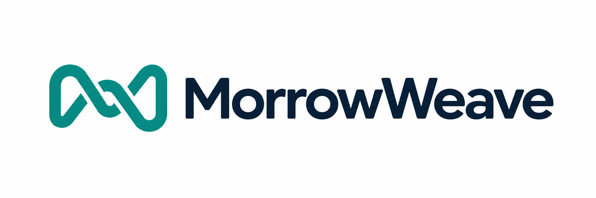
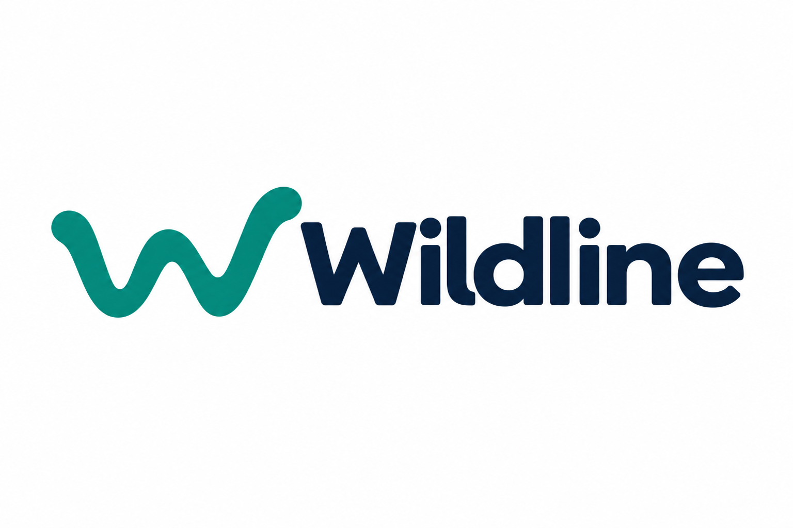

<p></p>

<p></p>

# Wildline · Living Legacy by MorrowWeave

What if the people you love could understand not only what happened in your life, but why it mattered—and how your understanding changed?

**MorrowWeave** is the venture. **Project Wildline** is the continuity project. **Lyra Nexus** is the memory-observatory interface. **Living Legacy** is the experience and longer-term product vision.

**[Enter the Living Legacy Reading Room — explore the Galaxy map](https://lyra-core-413.github.io/wildline-legacy-showcase/)** · [MorrowWeave](https://morrowweave.com/) · [Devpost project](https://devpost.com/software/wildline)

The current Reading Room is the Galaxy: 21 curated records and 11 labeled relationships across seven chapters. Select a star, inspect its source, or choose **Follow the Footsteps**. The public chapter explores how information overload led to the work called Wildline. Family access, broad public synchronization and graph-aware conversation remain future capabilities for this static presentation. The LYRA launcher opens ChatGPT separately; Voice starts manually and receives no automatic map context.

## Explore the Galaxy

The Reading Room is the interactive Galaxy map, rather than the earlier local Reading Room interface. Use **The whole journey**, chapter navigation, search, source inspection and **Follow the Footsteps**. Its chapters are Origins, Friction, Decisions, Growth, Building, Living Legacy and What Remains.

The presentation follows the Nexus format on the MorrowWeave website: a rotating central LYRA context, chapter constellations and nested record orbits. The chapter and story panels remain collapsible. These visual groupings organize the existing records; they add no historical relationships. The 11 labeled record relationships comprise three documented references and eight thematic reading connections.

The public chapter contains sourced paraphrases, interpretation, a documented correction and unknowns. Links support exploration; a line does not by itself establish causality. This approved presentation dataset is separate from Eric's private Nexus and does not fetch Bee or Core data.

The [Nexus concept journey on morrowweave.com](https://morrowweave.com/#galaxy) is a separate illustration with 120 fictional nodes and 175 illustrative connections across eight phases. Its design is shared with this Reading Room; its fictional records do not replace or enlarge this 21-record curated chapter. This alignment does not enable automatic data synchronization. [Public Nexus presentation boundaries](docs/PUBLIC-NEXUS-SYNC.md).

## Why it began

Eric bought an Amazon Bee, then used Bee context and ChatGPT to build a Daily Command Center for conversations, commitments and changing responsibilities. Repeated reconstruction across conversations led to the private Lyra Core, then to Wildline's portable continuity mechanisms and the Nexus visualization.

Living Legacy asks what a person could choose to preserve for the people they love: experiences, decisions, relationships, corrections and growth, with the sources and uncertainty visible.

**411 Recover → 413 Challenge → 412 Reconstruct.** Recover the relevant history, challenge a favorite interpretation and carry forward what survives while leaving room to change.

## Separate working components

| Component | What to examine | Scope |
| --- | --- | --- |
| [Living Legacy Galaxy](https://lyra-core-413.github.io/wildline-legacy-showcase/) | Browser experience and curated chapter | Static presentation; no model or private account connection |
| [Public Bee Bridge](https://github.com/Lyra-Core-413/wildline-bee-bridge-public) | Bee-track source, offline demo and optional consent-gated CLI adapter | Private records and operation receipts are excluded; no reviewer invitation needed to read code |
| [Continuity Reader](https://github.com/Lyra-Core-413/wildline-continuity-reader) | Separate MIT-licensed Open Source contribution | Fictional, rule-based, offline fresh-process recovery |

The October 12 recorded Bee retrieval in the video is separate from the October 11 historical validation. A separately retained lifecycle replay is historical evidence, not a new live mutation. Component test counts do not belong to the Galaxy.

## Run this static source locally

Use the hosted Galaxy for immediate access. To inspect a local copy, clone or extract this repository, install Python 3 separately, and run in its root:

```sh
python -m http.server 8000 --bind 127.0.0.1
```

On Windows, `py -3 -m http.server 8000 --bind 127.0.0.1` is an alternative. Open `http://127.0.0.1:8000/` on the same computer. Opening `index.html` directly may block JSON loading. No model key, Bee account or paid service is needed.

[Reviewer walkthrough](docs/REVIEWER-GUIDE.md) · [Public Nexus presentation boundaries](docs/PUBLIC-NEXUS-SYNC.md) · [Brand assets](docs/BRANDING.md)

## Private prototype progress

The separate owner-only Personal Galaxy now uses open constellation clusters, restrained connections and labels, local source inspection, Threads, Timeline, reversible identity review and a read-only Command Center with conflict flags. Permitted polling and owner phone access operate privately; neither public map connects to that environment. [October 18 audit: implemented behavior, verification and limits](docs/PRIVATE-NEXUS-PROGRESS.md). These private results are supplementary context, not features or test results of this public package.

## What remains future work

The longer-term vision is for a living author to choose the history and audience they want, and for authorized loved ones to explore those sources through conversational AI. Family access, automatic source synchronization and graph-aware voice are not implemented in this static chapter. Later family reflections would retain separate authorship.

The broader research question—whether governed continuity improves discovery over disconnected conversations—remains open. The current demonstrations do not establish that advantage.

## Status and evidence

The hosted map was inspected on October 18, 2026, showing its 21-record/11-link overview and chapter controls. Earlier local checks retain their original scope. The subsequent Nexus presentation alignment changes layout and appearance while preserving the approved curated dataset. The current October 18 Devpost Nexus Sync ZIP is a snapshot of commit `cfc65f7c2ae67339bd4231ff66aa365b7ae3ec20`; this documentation update preserves that archive; later default-branch notes are not part of its bytes.

The MIT grants for the Reader and Bridge are separate from this Galaxy presentation. This README does not add a license grant for the Galaxy or its artwork. MorrowWeave is an independent personal venture. This presentation update does not submit or change the submission status of the Devpost entry.

**Continuity without captivity. Carry forward what matters. Keep the freedom to reconsider.**

